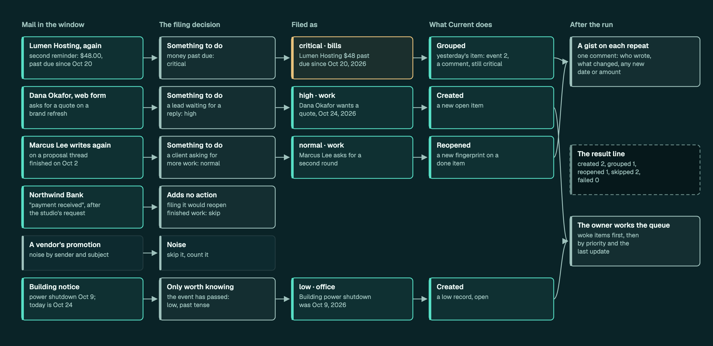
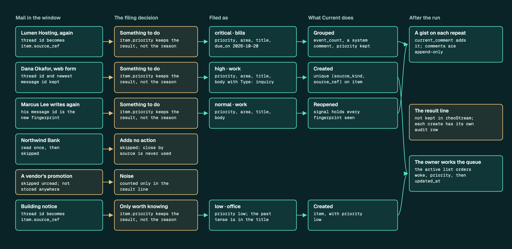
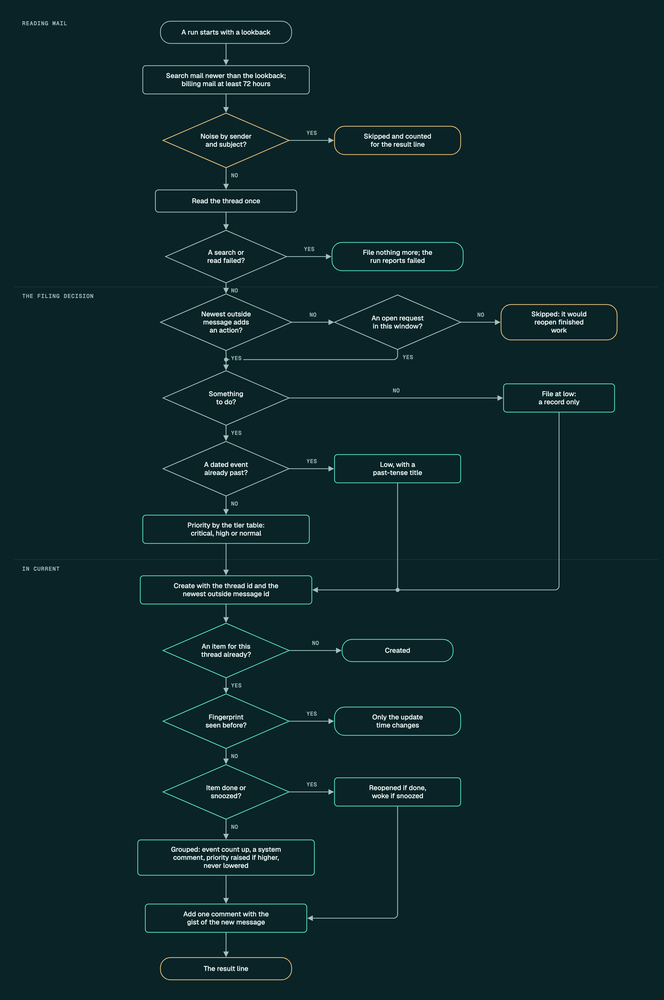

# Review package

A check of whether rheoStream's database holds the way its workflows are meant to run.
Each workflow is drawn twice: once as it should run, from rheoStream's own docs, and once
traced through the real tables. Every step is marked as having a home in the schema,
partly having one, or none yet. The worked examples use made-up people, companies and
mail; the rules and tables are real, read at commit `72b93ea`.

**The full package is at [rheo.stream/review](https://rheo.stream/review/)**: the
overview, each workflow's step-by-step table with sources, its decision tables, and a
flowchart with hover notes on every shape. Its source is in the
[rheo-stream-site](https://github.com/rheos/rheo-stream-site) repository, under
`public/review/`. This page keeps a summary and the images.

## What's there so far

| Part | State |
| --- | --- |
| Workflow maps: email intake into Current | Drawn |
| Workflow maps: the Upwork job feed through Leads, an agent action through approval, memory capture through recall | Not drawn yet |
| Schema map, architecture, delivery | Not drawn yet |

Tracking issue: #469.

## Email intake into Current

The rules come from [email intake](../guide/email-intake.md) and the repeated-signals
section of [Current](../guide/current.md#repeated-signals-become-one-item). Of 17 rules,
12 have a home in the schema and 5 partly have one. None is missing. Of the 21 decision
branches, 19 are fully handled.

### What it should do

One morning's run for a made-up two-person studio: a reminder for a bill filed yesterday,
a new lead, a client writing again on finished work, a "payment received" notice that
must not reopen anything, a promotion skipped unread, and an event that has already
happened.

### The same run in the schema

Every box from the picture above, outlined by how well Current's tables hold it, with the
table or column written in it.

### Flowchart

One thread through one run, from the mail search to the result line.

### What stands out

- **Repeats are handled in the database, not left to the agent.** A unique index makes
  one thread one item, done and snoozed items included. Fingerprints decide whether a
  repeat groups, reopens or wakes, the priority only climbs, and a repeat never rewrites
  what someone wrote.
- **The intake rules live outside the database.** The action gate, the priority tiers,
  the sender map and the mail types are agent rules and workspace configuration. The
  database keeps the result but not the reason, and a skipped thread leaves no trace.
- **A run leaves no record inside rheoStream.** Each create has its own audit row, but the
  run's window, its counts and a failed run exist only in the result line it prints.

### Questions

1. Should a "paid" or "resolved" notice close its item through
   `current_close_by_source`, instead of being skipped?
2. Should a run leave a record in rheoStream, so the screens can show when mail was last
   read and whether the last run failed?
3. Should the mail type be a field, so the queue can filter by it?
4. Should the sender map live in the workspace, where the screens can show and edit it?
